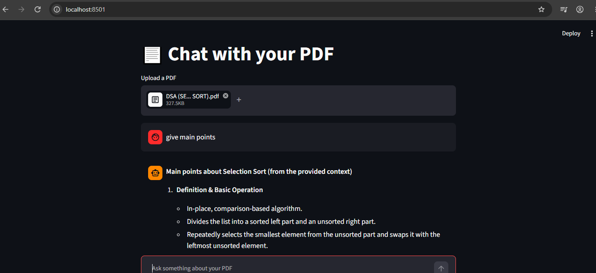

# 📄 Chat with your PDF (RAG App)

Upload any PDF and ask questions about it. The app finds the most relevant parts of the document and uses an LLM to answer based only on them.



## How it works
1. Extract text from the PDF using `pypdf`
2. Split the text into overlapping chunks
3. Create embeddings with `sentence-transformers` (all-MiniLM-L6-v2)
4. Retrieve the top 4 most similar chunks using cosine similarity
5. Send the chunks and the question to an LLM (Groq API) to generate the answer

This technique is called **RAG** (Retrieval-Augmented Generation).

## Tech stack
Python, Streamlit, sentence-transformers, NumPy, Groq API

## Run locally
```bash
git clone https://github.com/44-max/chat-with-your-pdf.git
cd chat-with-your-pdf
uv sync
```

Create a `.env` file and add your free Groq API key (get one at console.groq.com):
```
GROQ_API_KEY=your_key_here
```

Start the app:
```bash
uv run streamlit run app.py
```

## Future improvements
- Support multiple PDFs
- Show page numbers in the sources
- Use a vector database (FAISS or ChromaDB)
- Deploy online